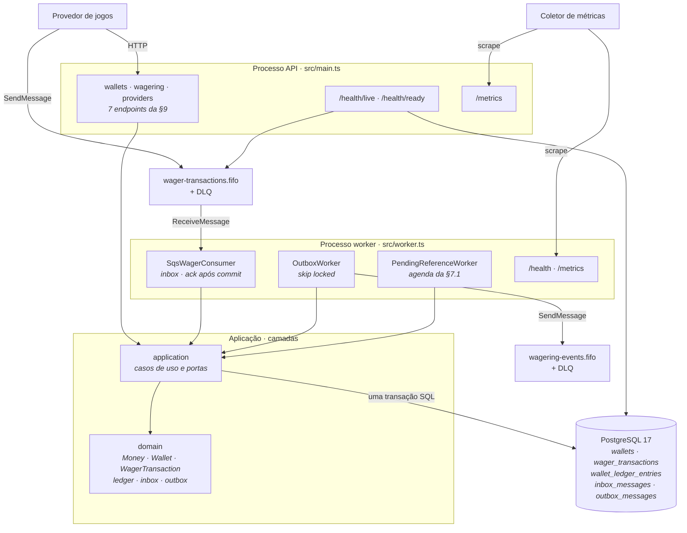

# Arquitetura — estado atual

Este documento conta o que existe hoje no repositório. Nada aparece aqui antes
de estar implementado. As decisões e seus trade-offs ficam em
[ARCHITECTURE.md](../../ARCHITECTURE.md) e nos [ADRs](../adr).

## Status

O sistema está **completo quanto aos requisitos obrigatórios do enunciado**, e
foi exercitado ponta a ponta contra a infraestrutura de verdade.

A aplicação assume dois papéis, escolhidos pelo entrypoint: a **API**
(`src/main.ts`) e o **processo de trabalho de fundo** (`src/worker.ts`), que
sobe o consumidor da fila, o publicador da outbox e o worker de referência
pendente.

O que roda hoje:

- os **sete endpoints** da seção 9, mais `/health/live`, `/health/ready` e
  `/metrics`;
- o **consumidor SQS**, com deduplicação por inbox no mesmo commit do efeito
  financeiro, `ack` somente após o commit, classificação de erro em três
  classes e encerramento gracioso no `SIGTERM`;
- o **publicador da outbox**, com vários publicadores concorrentes
  coordenados por `for update skip locked`, e fila de saída própria;
- o **worker de referência pendente**, executando a agenda de 8 tentativas em
  24 horas;
- **logs estruturados em JSON** com os cinco campos de correlação da seção 12,
  e **onze métricas** expostas em texto Prometheus;
- o domínio financeiro puro, o schema com as garantias da restrição 9 em
  constraints, e os repositórios com lock pessimista por wallet.

**605 testes passam**: 433 de unidade e smoke, 161 de integração contra
PostgreSQL 17.6 e MiniStack reais, e 11 de concorrência com processos de
verdade. Ver [Verificação](#verificação).

O que **não** existe: autenticação, por decisão registrada
([ARCHITECTURE.md](../../ARCHITECTURE.md) §8), e teste de carga, que o
enunciado trata como diferencial opcional.

## Diagrama de componentes

Todas as ligações abaixo foram exercitadas contra os serviços reais.



Três coisas ficam visíveis aí. As quatro portas de entrada — HTTP, fila,
publicador e worker de referência — convergem para os **mesmos** casos de uso.
O domínio não é alcançado por ninguém de fora da camada de aplicação. E o
evento nunca sai da transação financeira: ele é gravado no PostgreSQL e
publicado depois, por outro processo.

## Regra de dependência

As setas apontam para dentro:

| Camada           | Pode referenciar        | Estado                                      |
| ---------------- | ----------------------- | ------------------------------------------- |
| `domain`         | nada                    | implementado — sem nenhum import de ORM     |
| `application`    | `domain`                | portas, contratos e nove casos de uso       |
| `infrastructure` | `application`, `domain` | persistência, mensageria, observabilidade   |
| `interfaces`     | `application`, `domain` | `http` com 10 rotas e `workers` com os três |
| `config`         | nada além de zod        | implementado                                |
| `shared`         | nada                    | implementado                                |

Numa solução .NET, as referências de projeto fariam o compilador impor essa
regra. Aqui não: nada no build impede um import que a viole, e quem sustenta a
restrição é a revisão de código. Uma regra de ESLint sobre caminhos de import
passaria a conferir isso automaticamente, e continua não existindo — é a
limitação registrada em [ARCHITECTURE.md](../../ARCHITECTURE.md) §11.

Duas travessias merecem nota, porque parecem violações e não são:

- `interfaces/workers` importa de `infrastructure` para montar o consumidor e
  os workers. É composição, não regra de negócio — o mesmo papel que
  `ApiModule` cumpre ao importar `UseCasesModule`.
- `infrastructure/composition/use-cases.module.ts` instancia os casos de uso à
  mão. É o preço de os casos de uso não terem nenhum import de framework, e
  é essa propriedade que os torna testáveis sem subir Nest.

Quem lê o ambiente é só o `config`. O `EnvService` entrega a configuração
pronta, e nenhuma camada abaixo dele chega perto de `process.env`.

## Aspectos transversais

**Configuração.** O contrato está em `src/config/env.schema.ts`, escrito em
zod. A validação roda uma vez, na inicialização, e reclama de **todas** as
variáveis inválidas de uma vez. É ali também que o sufixo `.fifo` das quatro
filas é conferido, e que o prazo de requisição do SQS é validado contra o long
poll de 20 s: um timeout menor abortaria todo recebimento normal sem acusar
erro.

**Saúde.** Liveness e readiness são endpoints distintos, e os dois processos os
expõem — o worker em porta própria. Um worker sem sonda é indistinguível de um
worker travado. Cada verificação do readiness tem prazo próprio, com
`AbortSignal`; medido, um SQS que aceita a conexão e nunca responde produz
`503` em 2,02 s. Ver
[ADR-009](../adr/ADR-009-prazos-explicitos-de-indisponibilidade.md).

**Logs.** Uma linha JSON por registro, escrita direto em `stdout` — sem passar
pelo `Logger` do Nest, cujo prefixo e cores ANSI quebrariam o parsing. Os
campos de correlação (`correlationId`, `messageId`, `transactionId`,
`walletId`, `providerId`) ficam no topo do objeto. O tipo do contexto só aceita
escalares, o que torna impossível passar um objeto de domínio por engano — é
assim que a proibição de payload financeiro da seção 12 é garantida.

**Métricas.** Onze séries declaradas num catálogo único, expostas em
`GET /metrics` em texto Prometheus, sem nenhuma dependência de runtime. Toda
série é emitida **em zero** antes da primeira observação, de modo que "não
aconteceu" seja distinguível de "não está instrumentado". O registry é por
processo, de propósito: agregar é trabalho do coletor. Ver
[ADR-014](../adr/ADR-014-observabilidade-sem-dependencia-nova.md).

**Encerramento.** Os dois entrypoints chamam `enableShutdownHooks()`. No
`SIGTERM`, o consumidor para de receber, cancela o `ReceiveMessage` em curso
com `AbortSignal`, espera o lote em andamento e, se o prazo estourar, devolve
a visibilidade das mensagens restantes. Os dois workers de polling têm um
`sleep` que **acorda** no shutdown — sem isso, um worker ocioso levaria o
intervalo inteiro para encerrar.

**Erros.** Falha de transporte é reconhecida por SQLSTATE e código de socket,
sem depender da classe do invólucro do ORM, e vira `503` no HTTP ou
reentrega na fila. O mapeamento de código de falha para status HTTP é um
`Record` **total**: um código novo sem status definido não compila.

## Persistência

MikroORM 7 com o driver de PostgreSQL. Uma função só, `buildMikroOrmConfig`,
monta a configuração, e dois chamadores a consomem: o módulo Nest e a CLI de
migrations. Manter uma definição única evita que a aplicação e as migrations
passem a discordar sobre o schema.

O `connect: false` é proposital: a aplicação sobe mesmo com o banco fora do ar
e passa a reportar readiness como indisponível, em vez de morrer na
inicialização. Assim um orquestrador diferencia um processo quebrado de uma
dependência fora do ar.

Existe uma migration, a `Migration20261030113000_financial_core`, e ela cria o
schema financeiro inteiro: `wallets`, `wager_transactions`,
`wallet_ledger_entries`, `inbox_messages` e `outbox_messages`. O ciclo `up` →
`down` → `up` foi executado contra o banco real, e o `down` não deixa tabela
nem função atrás.

As garantias que a restrição 9 manda viver no schema estão lá: **37
constraints, 3 triggers de append-only no ledger e 4 índices parciais** — entre
eles o que impede a mesma referência de ser revertida duas vezes pelo mesmo
tipo, e o de pendentes da outbox. Cada uma tem um caso de teste que escreve
SQL cru por fora do domínio e verifica a recusa.

A fronteira transacional é `UnitOfWork.run`, e os repositórios **só existem
dentro dela**: são entregues ao callback, construídos sobre o `EntityManager`
da transação. Não é cerimônia — é o que impede uma escrita de escapar da
transação, porque fora de `run` não há objeto com que fazê-la.

As cinco entidades registradas são **modelos de persistência**, não as classes
de domínio, e mappers explícitos fazem a tradução. Ver
[ADR-008](../adr/ADR-008-mapeamento-de-persistencia.md).

## Mensageria

Cliente do AWS SDK v3. O endpoint só é sobrescrito quando existe um emulador
configurado; com `SQS_ENDPOINT` vazio, o SDK resolve o endpoint real da AWS.
Esse é o único ponto do código que sabe da possibilidade de haver um
emulador — e nem ele sabe qual.

A topologia fica em `src/infrastructure/messaging/queue-topology.ts`, para que
o script de bootstrap, os health checks e os testes não discordem sobre nomes
e atributos. São **quatro filas**:

| Fila                          | Papel                                  |
| ----------------------------- | -------------------------------------- |
| `wager-transactions.fifo`     | entrada: comandos dos provedores (§10) |
| `wager-transactions-dlq.fifo` | DLQ da entrada                         |
| `wagering-events.fifo`        | saída: eventos de integração (§11)     |
| `wagering-events-dlq.fifo`    | DLQ da saída                           |

A fila de saída não vem do enunciado — ela é decisão registrada no
[ADR-012](../adr/ADR-012-fila-de-saida-de-eventos.md). Publicar evento na fila
de entrada faria o próprio consumidor recebê-lo de volta.

| Atributo                        | Valor   | Razão                                                                        |
| ------------------------------- | ------- | ---------------------------------------------------------------------------- |
| `FifoQueue`                     | `true`  | exigido pelo enunciado                                                       |
| `ContentBasedDeduplication`     | `false` | duas operações legítimas podem ter corpo idêntico; quem publica informa o id |
| `VisibilityTimeout`             | 30s     | maior que o pior caso de processamento                                       |
| `MessageRetentionPeriod`        | 4 dias  | cobre um fim de semana de indisponibilidade                                  |
| `ReceiveMessageWaitTimeSeconds` | 20s     | long polling                                                                 |
| `maxReceiveCount`               | 5       | absorve queda curta do banco; isola mensagem venenosa                        |

Nas duas direções o **grupo é a `walletId`**: é ela a unidade de concorrência
e a fronteira de consistência. E nas duas o `MessageDeduplicationId` é
explícito — o `messageId` na entrada, o `eventId` na saída.

A deduplicação do broker tem janela de cinco minutos, e por isso vale como
**otimização, não como garantia**. Quem garante é o inbox persistente, como
manda a restrição 3.

## Testes

| Escopo          | Diretório                 | Dependências                | Resultado |
| --------------- | ------------------------- | --------------------------- | --------- |
| Unidade e smoke | `test/unit`, `test/smoke` | nenhuma                     | 433 ✓     |
| Integração      | `test/integration`        | PostgreSQL e MiniStack      | 161 ✓     |
| Concorrência    | `test/concurrency`        | ambos, mais processos reais | 11 ✓      |

```bash
bun run test              # 433, sem infraestrutura
bun run test:integration  # 161, contra serviços reais
bun run test:concurrency  # 11, com processos de verdade
bun run test:all          # os três em sequência
```

As duas últimas rodam **um arquivo por processo**, pelo
`scripts/run-suite.ts`. A razão é mecânica: cada suíte aponta para o seu banco
e as suas filas ajustando `process.env` antes de importar `ConfigModule`, e o
`NestConfigModule.forRoot` é avaliado no import, que o processo cacheia. Num
processo compartilhado, o segundo arquivo recebia o `ConfigModule` do primeiro
e os seus workers operavam no banco errado.

**Nenhum teste troca PostgreSQL ou SQS por dublê.** Dois arquivos usam dublês,
e os declaram no topo:

- `test/unit/health-timeout.spec.ts` — provar que o readiness responde quando
  a dependência **não** responde exige uma dependência que trave sob demanda;
- `test/unit/sqs-consumer.spec.ts` — o que ele verifica é a **ordem** dos
  comandos que o consumidor emite ao broker (`ack` depois do commit, DLQ antes
  da confirmação), e provar ordem contra um serviço real exigiria travá-lo sob
  demanda.

O escopo de integração cobre, além dos sete endpoints: as garantias do
schema contra SQL cru, a ida e volta entre domínio e banco, o consumidor com
redelivery e DLQ, o publicador com recuperação de evento órfão, a agenda de
referência pendente, e a **atomicidade das cinco escritas** com rollback
comprovado.

O escopo de concorrência cobre os oito cenários da seção 13, com três
instâncias de API e até três workers em processos separados. Ver
[ADR-015](../adr/ADR-015-execucao-multi-instancia-e-testes-de-concorrencia.md).

Todo cenário que move saldo termina com a invariante final da seção 13,
conferida em SQL cru:

```
wallet.balance == saldo reconstruído pelo ledger
```

## Verificação

Executada em 2026-10-30, no Windows 10 com Docker 29.7.2 sobre WSL 2.

| Verificação                                     | Resultado                             |
| ----------------------------------------------- | ------------------------------------- |
| `bun run check`                                 | exit 0 — typecheck, lint, formatação  |
| `bun run test`                                  | 433 passando, 0 falhando              |
| `bun run test:integration`                      | 161 passando em 10 arquivos           |
| `bun run test:concurrency`                      | 11 passando em 2 arquivos             |
| `bun run infra:up`                              | PostgreSQL e MiniStack `healthy`      |
| `bun run queues:bootstrap`                      | quatro filas, idempotente             |
| `bun run infra:check`                           | PG 17.6; as duas filas FIFO com DLQ   |
| `migration:up` → `down` → `up`                  | aplica e reverte sem resíduo          |
| contagem lida do catálogo do PostgreSQL         | 37 constraints, 3 triggers, 4 índices |
| `docker compose --profile app up --scale api=3` | 3 réplicas + worker, todas `healthy`  |

### Ponta a ponta, em contêiner

Com três réplicas no ar (portas 3000, 3001 e 3002) e o worker em 3100:

1. wallet criada na réplica **:3000** → saldo `1000.00`, `version` 1;
2. `BET` de `25.00` na réplica **:3001** → `PROCESSED`, saldo `975.00`;
3. a **mesma** `Idempotency-Key` reenviada na réplica **:3002** → mesmo
   `transactionId`, mesmo saldo, `idempotentReplay: true`;
4. reconciliação em **:3000** → `consistent: true`, `difference: 0.00`,
   `checkedEntries: 2`;
5. mensagem publicada em `wager-transactions.fifo` → consumida pelo worker em
   **~1 s**, saldo `875.00`, eventos publicados na fila de saída.

O passo 3 é a evidência mais direta de que a idempotência é **persistente e
atravessa instâncias**: a réplica que respondeu o replay não é a que gravou a
transação, e nenhuma delas compartilha memória com a outra.

A contagem de constraints foi lida de volta do catálogo do PostgreSQL depois
da migration aplicada, e não contada no arquivo da migration — são 23 `check`,
5 `unique`, 4 foreign keys e 5 chaves primárias nas cinco tabelas
financeiras. Vale registrar que uma versão anterior deste documento afirmava
39; o número não se reproduziu na medição e foi corrigido.

```sql
select c.contype, count(*)
  from pg_constraint c
  join pg_class t on t.oid = c.conrelid
  join pg_namespace n on n.oid = t.relnamespace
 where n.nspname = 'public'
   and t.relname in ('wallets', 'wager_transactions',
                     'wallet_ledger_entries', 'inbox_messages',
                     'outbox_messages')
 group by c.contype;
```

### O que continua sem verificação

- **A equivalência entre MiniStack e o SQS da AWS nas bordas.** As quatro
  capacidades que o desenho usa passaram — FIFO com `RedrivePolicy`, entrega
  com `MessageGroupId`, deduplicação por `MessageDeduplicationId` e redrive ao
  esgotar o `maxReceiveCount` —, mas a janela de deduplicação de cinco minutos
  e a ordenação estrita por grupo sob contenção não foram exercitadas.
- **Carga.** Nenhuma medição de throughput, latência percentil ou outbox lag
  sob pressão. O teste de carga é diferencial opcional no enunciado e ficou
  fora do escopo.
- **A regra de dependência entre camadas**, que depende de revisão de código
  enquanto não existir regra de ESLint que a verifique.
- **Autenticação**, por decisão registrada. O `ProviderIdentityPort` tem
  implementação no-op e é exercitado por teste de unidade, inclusive no
  caminho autenticado.

## Ainda não construído

Autenticação com Identity Provider externo, teste de carga
(`bun run test:load`), ledger de partidas dobradas, e a regra de ESLint da
fronteira entre camadas. Os três primeiros são explicitamente opcionais no
enunciado; o quarto é limitação conhecida, registrada em
[ARCHITECTURE.md](../../ARCHITECTURE.md) §11.
